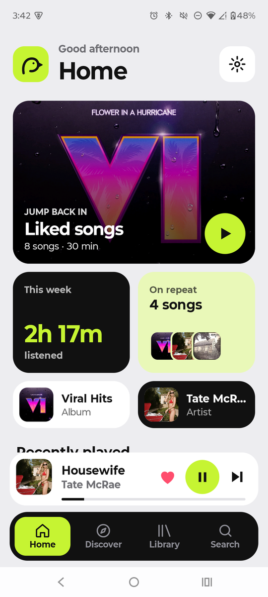
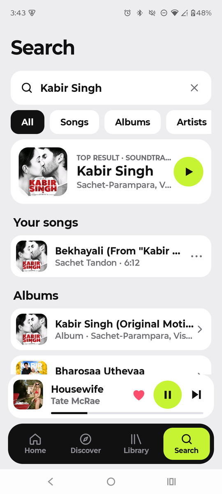
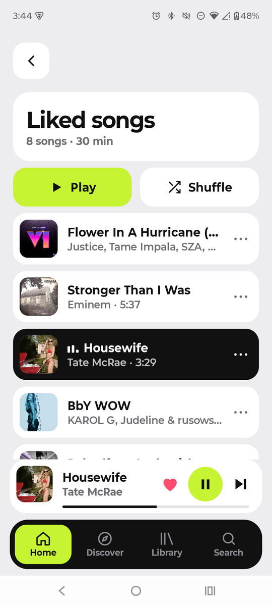
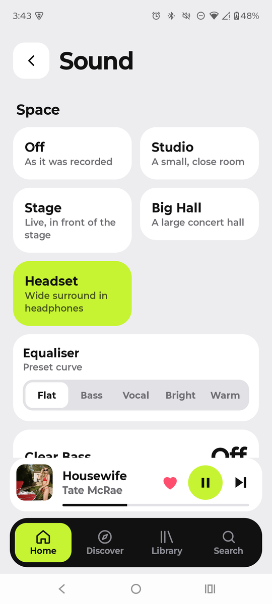

# MYNA

A music player for Android with a bold Bento look: lime and ink tiles, big type, and no clutter.
It plays songs from the web and from your phone, learns what you like, and gives you a fresh mix every day.

<p>
  
  
  
  
</p>
<p>
  
  
</p>

## What it does

- **Home:** jump back in, your listening time this week, songs on repeat and recently played.
- **Discover:** "Your mix" and "Because you play…" shelves, built from what you play.
- **Search:** songs, albums and artists. A film name such as *Kabir Singh* finds the film's soundtrack.
- **Now Playing:** crossfade, synced lyrics, queue, a sleep timer and the output device.
- **Sound:** spaces (Studio, Stage, Big Hall, Headset), an equaliser and Clear Bass. The spaces run inside MYNA's own player, so they work on any phone and any speaker.
- **Lock screen:** media controls in the notification. Tap the art and it fills the lock screen without unlocking the phone.
- **Library:** liked songs, playlists, and the songs on your phone.

## Install

Download the APK from [Releases](../../releases) and open it on your phone.
Android asks once to allow installs from your browser or file app.

Needs Android 8.0 or newer.

## Build

Built with Kotlin Multiplatform and Compose Multiplatform, using Media3 ExoPlayer for playback.

```sh
./gradlew :composeApp:assembleDebug
adb install -r composeApp/build/outputs/apk/debug/composeApp-debug.apk
```

| Folder | What's in it |
|---|---|
| `composeApp/src/commonMain` | Shared UI, the player engine, search and recommendations |
| `composeApp/src/androidMain` | Android playback, media controls, the lock screen player and sound effects |
| `design/` | Mockups and design notes |
