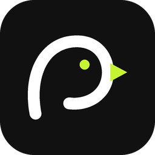
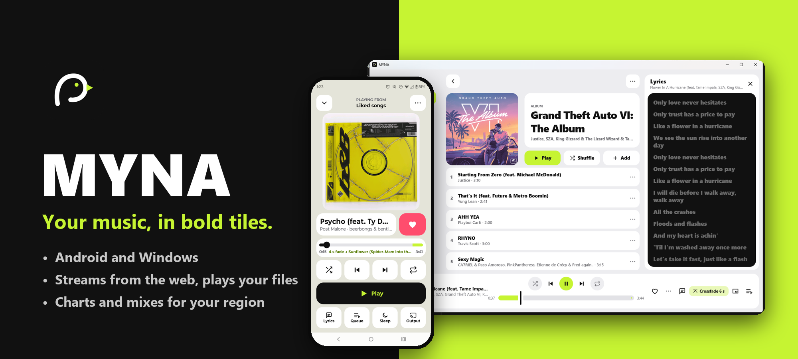
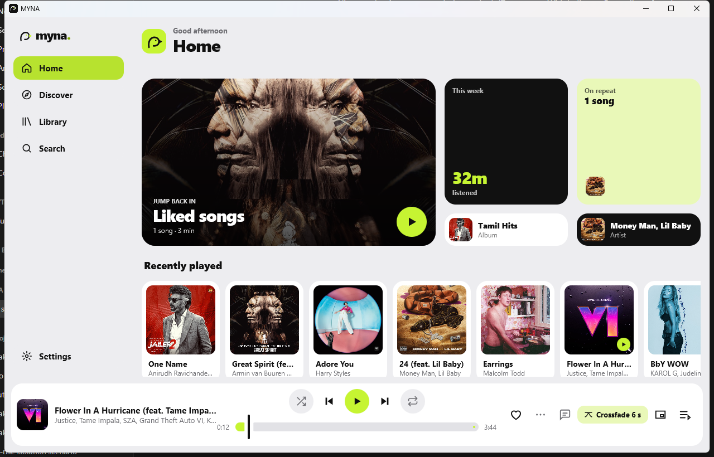
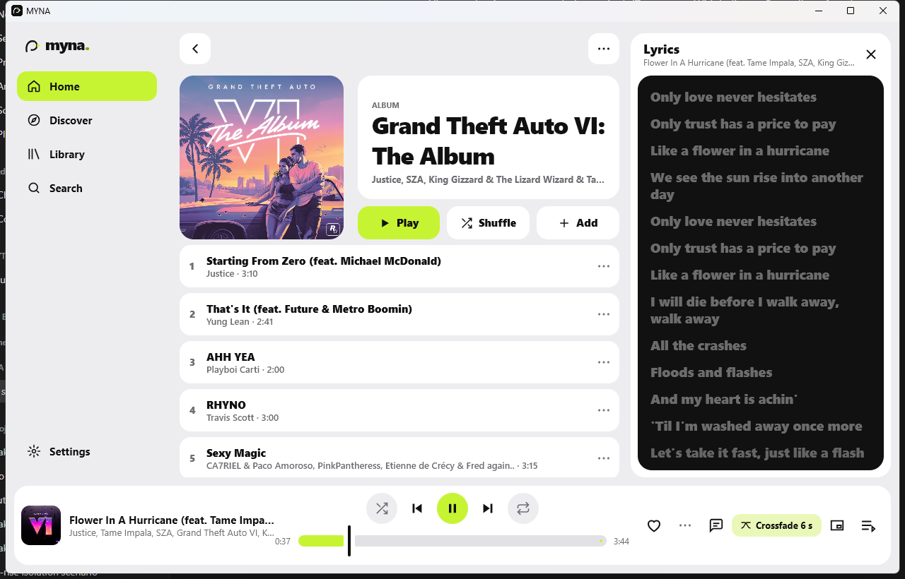
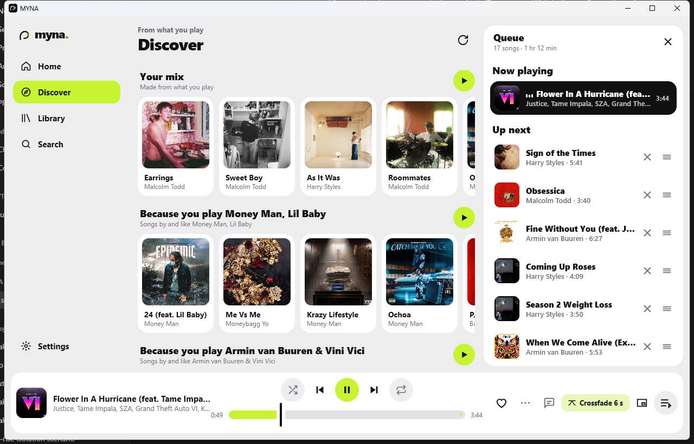
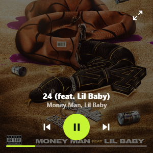
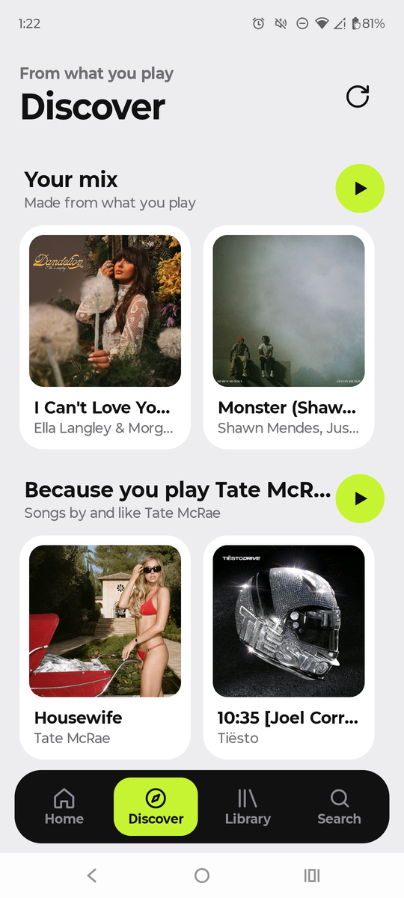
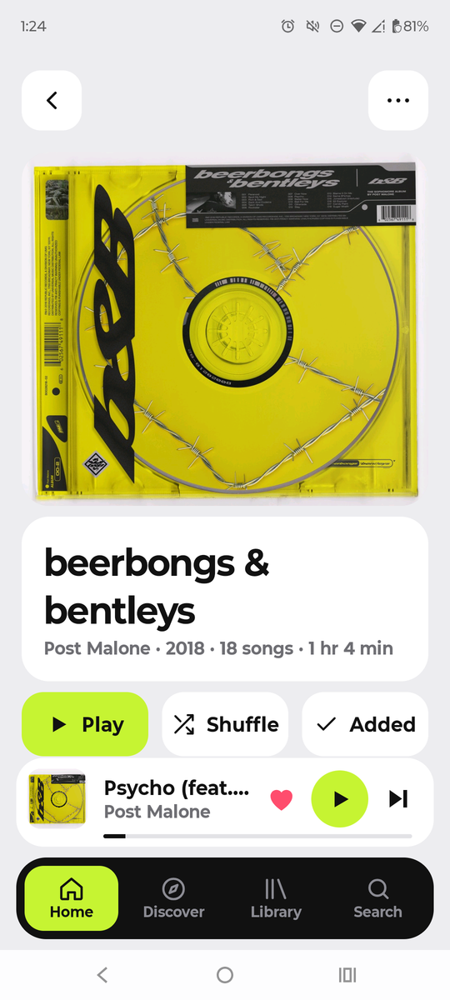
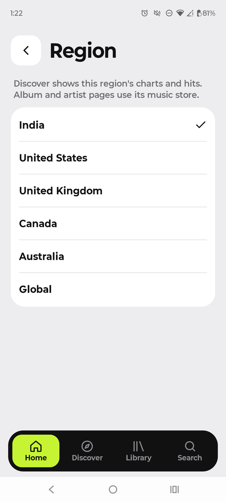
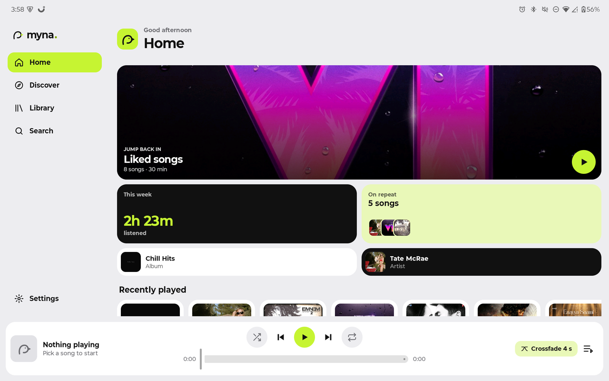

<div align="center">

<br/>



# MYNA

### Your music, in bold tiles

<br/>

[](https://github.com/suryablaze02-byte/MYNA/releases)
[](https://github.com/suryablaze02-byte/MYNA/releases)
[](#download)
[](#download)
[](https://ko-fi.com/suryavardhan1)

<br/>

[**Features**](#features) · [**Screenshots**](#screenshots) · [**Download**](#download) · [**Install**](#install) · [**Build**](#build) · [**Contributing**](#contributing) · [**Support**](#support) · [**Disclaimer**](#disclaimer)

</div>

> [!IMPORTANT]
> MYNA is an independent project. It is **not** affiliated with, endorsed by, or connected to YouTube, Google, Spotify, Apple, LRCLIB or Deezer in any way. Use it at your own discretion.

<div align="center">
<br/>

</div>

---

MYNA is a music player for Android and Windows with a bold Bento look: lime and ink tiles, big
type, and no clutter. It plays songs from the web and from your phone or PC, learns what you
like, and builds you a fresh mix every day. Pick your region and Discover fills up with that
country's charts and hits. Tap ⋯ on any song to jump to its full album or its artist.

<h2 id="features">Features</h2>

<table>
  <tr>
    <td width="50%" valign="top">

#### Listening
- **Home**: jump back in, your listening time this week, songs on repeat and recently played, laid out as Bento tiles.
- **Discover**: *Your mix* and *Because you play…* shelves built from what you play, plus Spotify and Apple Music charts.
- **Region**: India, United States, United Kingdom, Canada, Australia or Global. Discover shows that region's Top 50 and hits, and album pages use its music store.
- **Search**: songs, albums and artists. A film name such as *Kabir Singh* finds the film's soundtrack.
- **Go to album**: from any song, opens its full album with every song on it, even for songs you stream.
- **Now Playing**: crossfade, swipe the cover to change song, synced lyrics, the queue, a sleep timer and the output device.

#### Your library
- **Liked songs and playlists**: the heart turns red when you like a song.
- **Add to library**: keep an online song, or a whole album in one tap.
- **Songs on your phone or PC**, sorted into albums, artists and folders.

    </td>
    <td width="50%" valign="top">

#### Sound
- **Spaces**: Studio, Stage, Big Hall and Headset. They run inside MYNA's own player, so they work on any speaker.
- **Equaliser and Clear Bass** (Android).
- **Crossfade** between songs, and a short fade when you skip.

#### On Windows
- **Sidebar and player bar**: a desktop layout, not a stretched phone.
- **Lyrics panel** beside the page; the line being sung is shown in lime.
- **Queue panel**: drag songs to change the order, or remove them.
- **Mini player**: just the album art and the controls, always on top.

#### On the phone
- **Lock screen player**: tap the art in the notification and it fills the lock screen without unlocking.
- **Media controls** in the notification, and on headphones and in the car.

#### Updates itself
- MYNA checks GitHub once a day. When a new version is out, a lime banner on Home installs it in one tap.

    </td>
  </tr>
</table>

<h2 id="screenshots">Screenshots</h2>

#### Windows

<div align="center">
<table>
  <tr>
    <td align="center"><br/><sub>Home: your music as Bento tiles</sub></td>
    <td align="center"><br/><sub>Go to album, with the lyrics panel open</sub></td>
  </tr>
  <tr>
    <td align="center"><br/><sub>Discover, with the queue you can reorder</sub></td>
    <td align="center"><br/><sub>The mini player stays on top</sub></td>
  </tr>
</table>
</div>

#### Phone

<div align="center">
<table>
  <tr>
    <td align="center"><br/><sub>Home</sub></td>
    <td align="center"><br/><sub>Discover</sub></td>
    <td align="center"><br/><sub>Now Playing</sub></td>
    <td align="center"><br/><sub>Go to album</sub></td>
  </tr>
  <tr>
    <td align="center"><br/><sub>Region</sub></td>
    <td align="center"><br/><sub>Search</sub></td>
    <td align="center"><br/><sub>Liked songs</sub></td>
    <td align="center"><br/><sub>Sound</sub></td>
  </tr>
</table>
</div>

#### Tablet

<div align="center">
<br/><sub>On a tablet: a sidebar and a full-width player bar</sub>
</div>

<h2 id="download">Download</h2>

Grab the latest version from the [**Releases**](https://github.com/suryablaze02-byte/MYNA/releases) page. After that, MYNA tells you when a new version is out and installs it from **Home**.

Or get the Android app with [Obtainium](https://github.com/ImranR98/Obtainium), which installs straight from these releases and keeps the app updated:

[](https://apps.obtainium.imranr.dev/redirect?r=obtainium://app/%7B%22id%22%3A%22com.myna.player%22%2C%22url%22%3A%22https%3A%2F%2Fgithub.com%2Fsuryablaze02-byte%2FMYNA%22%2C%22author%22%3A%22suryablaze02-byte%22%2C%22name%22%3A%22MYNA%22%2C%22additionalSettings%22%3A%22%7B%5C%22apkFilterRegEx%5C%22%3A%5C%22MYNA-v%5B%5C%5C%5C%5Cd.%5D%2B%5C%5C%5C%5C.apk%5C%22%7D%22%7D)

If nothing happens, open the link in Chrome rather than the GitHub app. Or add it by hand: in Obtainium, tap **Add App**, paste `https://github.com/suryablaze02-byte/MYNA`, and set the **APK filter** to `MYNA-v[\d.]+\.apk`.

| File | For |
|---|---|
| **MYNA-vX.Y.Z.apk** | Android phones and tablets |
| **MYNA-X.Y.Z.exe** | Windows 10 and 11 (64-bit). Installs for your user only, with a Start menu entry and a desktop shortcut. |

| Needs | |
|---|---|
| Android 8.0+ | the Android app |
| Windows 10+ (64-bit) | the Windows app |

<h2 id="install">Install</h2>

<div align="center">

[](https://github.com/suryablaze02-byte/MYNA/releases/latest)

</div>

#### 📱 Phone or tablet

1. On your phone, open the [latest release](https://github.com/suryablaze02-byte/MYNA/releases/latest) and tap **MYNA-vX.Y.Z.apk** under *Assets*.
2. Open the downloaded file. If Android asks, allow installing from this source.
3. Tap **Install**. If Play Protect doesn't recognise the app, tap **More details › Install anyway**.

#### 💻 Windows

1. Open the [latest release](https://github.com/suryablaze02-byte/MYNA/releases/latest) and download **MYNA-X.Y.Z.exe** under *Assets*.
2. Run it. The installer isn't signed yet, so Windows SmartScreen may warn you: click **More info › Run anyway**.
3. Click through the setup. MYNA appears in the Start menu and reads songs from your Music folder (change it in **Settings › Library**).

<h2 id="build">Build</h2>

Requires JDK 17 and the Android SDK. Built with Kotlin Multiplatform and Compose Multiplatform; Android plays through Media3 ExoPlayer, Windows through FFmpeg.

```bash
./gradlew :composeApp:assembleDebug   # Android APK
./gradlew :composeApp:run             # Windows app
./gradlew :composeApp:packageExe      # Windows installer
```

The APK lands in `composeApp/build/outputs/apk/debug/`, the installer in `composeApp/build/compose/binaries/main/exe/`.

| Folder | What's in it |
|---|---|
| `composeApp/src/commonMain` | Shared UI, the player engine, search, Discover and recommendations |
| `composeApp/src/androidMain` | Android playback, media controls, the lock screen player and sound effects |
| `composeApp/src/desktopMain` | Windows: FFmpeg playback, the Music folder, the mini player |
| `composeApp/src/jvmShared` | Shared by both: online music, lyrics and the sound spaces |
| `design/` | Mockups and design notes |

<h2 id="contributing">Contributing</h2>

Bug reports and ideas are welcome. [Open an issue](https://github.com/suryablaze02-byte/MYNA/issues) with what you did, what you expected and what happened, and a screenshot if you can.

<div align="center">

<h2 id="support">Support</h2>

MYNA is free and always will be. If it has kept you company, you can chip in on Ko-fi from anywhere, or over UPI in India:

<br/>

<table>
  <tr>
    <td align="center" width="50%">
      <b>Ko-fi</b> · worldwide<br/><br/>
      <a href="https://ko-fi.com/suryavardhan1"></a><br/><br/>
      <sub><a href="https://ko-fi.com/suryavardhan1">ko-fi.com/suryavardhan1</a></sub>
    </td>
    <td align="center" width="50%">
      <b>UPI</b> · India<br/><br/>
      <br/>
      <sub>UPI ID: <code>mochi.vardhan@federal</code> · Surya Vardhan</sub>
    </td>
  </tr>
</table>

</div>

<h2 id="disclaimer">Disclaimer &amp; legal notice</h2>

MYNA is an independent music player. It is **not** associated with Google LLC, YouTube, YouTube Music, Spotify, Apple, LRCLIB, Deezer, or any of their parent companies.

* **No media hosting.** MYNA does not host, upload or store copyrighted music. It plays files already on your device, or streams from public sources at the time you play them. Streamed songs are never saved.
* **Your responsibility.** MYNA is made for personal, non-commercial use. You are responsible for making sure your use complies with the copyright laws where you are and with the terms of service of every service you use (including YouTube's).
* **Unofficial interfaces.** Streaming relies on unofficial interfaces ([NewPipeExtractor](https://github.com/TeamNewPipe/NewPipeExtractor)). They can stop working at any time, and their use may not be permitted by those services' terms. Spotify and Apple Music playlists are read from their public pages; their songs are found and played from YouTube.
* **No guarantees.** MYNA is provided "as is", without warranty of any kind.
* **Trademarks.** YouTube, YouTube Music, Android and Google are trademarks of Google LLC; Spotify is a trademark of Spotify AB; Apple Music and iTunes are trademarks of Apple Inc.; Windows is a trademark of Microsoft. They are used here only to describe compatibility.

<h2 id="credits">Credits</h2>

MYNA builds on open-source work, including [Compose Multiplatform](https://github.com/JetBrains/compose-multiplatform), [AndroidX Media3 / ExoPlayer](https://github.com/androidx/media), [NewPipeExtractor](https://github.com/TeamNewPipe/NewPipeExtractor) for streams, [JavaCV / FFmpeg](https://github.com/bytedeco/javacv) for playback on Windows and [jaudiotagger](https://bitbucket.org/ijabz/jaudiotagger) for song tags. Album and artist pages and cover art use the iTunes Search API, and lyrics come from [LRCLIB](https://lrclib.net).

<div align="center">
<br/>
<sub>Made with passion ❤️ by Surya</sub>
</div>
